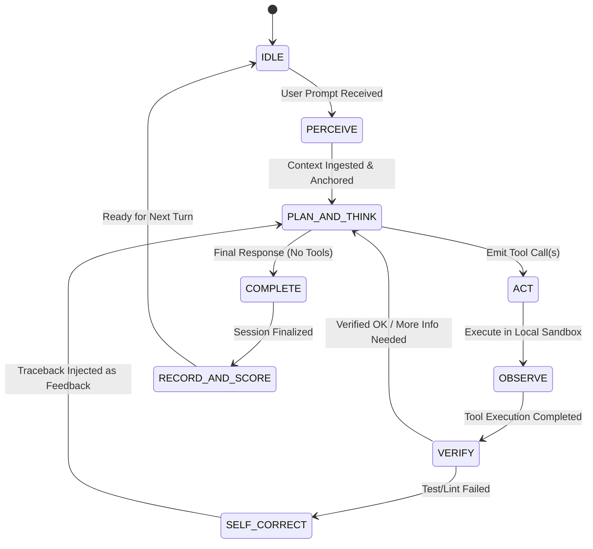
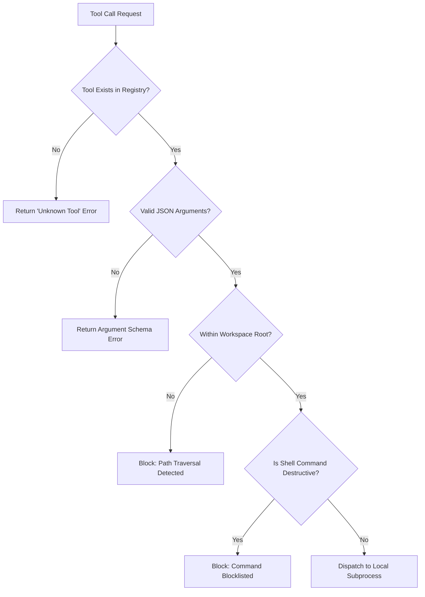
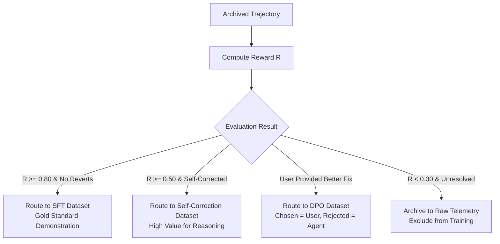
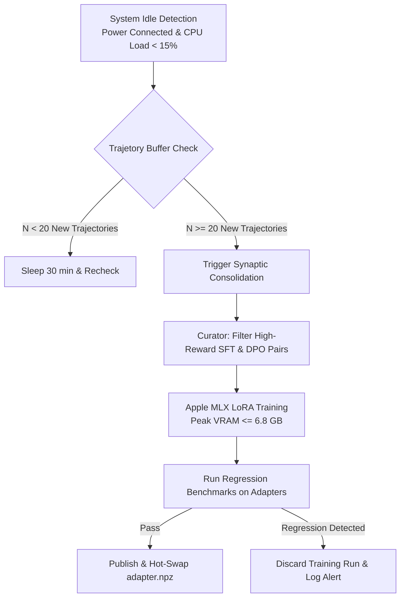
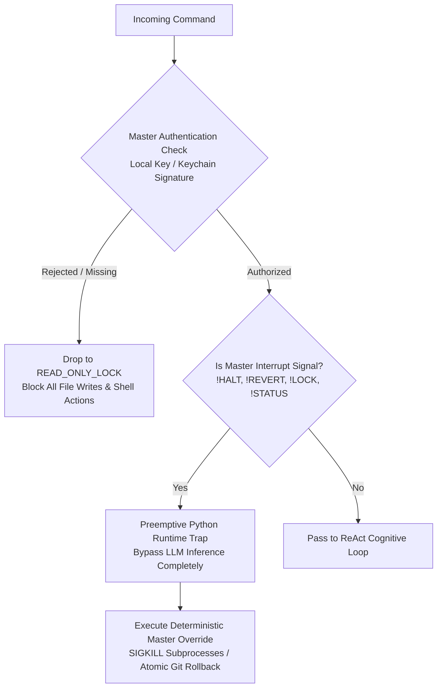
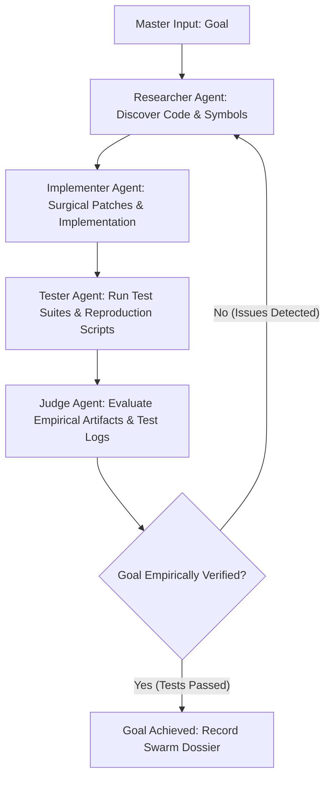

# Algorithms, Decision Logic & Cognitive State Machine ("Project Genesis")

> **Purpose**: This document formalizes the mathematical formulations, decision logic trees, heuristic scoring functions, and algorithmic state machines governing the autonomous operation, context budgeting, and self-improving dataset curation of the local AI agent on a 16 GB Apple Silicon system.
>
> 📖 **Companion Documents**:
> - **System Blueprint & Roadmap**: [implementation_plan.md](file:///Users/sabyasachiroy/projects/Learning/Details/implementation_plan.md)
> - **Multi-Agent Team Roster**: [team.md](file:///Users/sabyasachiroy/projects/Learning/Details/team.md)

---

## 1. Cognitive State Machine & The Autonomous Loop

The agent operates as a **Deterministic Cognitive State Machine** driven by a closed-loop ReAct (Reason + Act) + Verify architecture.



### 1.1 Formal State Transition Definitions

Let the cognitive state at discrete step $t$ be $S_t \in \mathcal{S}$, where:
$$\mathcal{S} = \{\text{IDLE}, \text{PERCEIVE}, \text{THINK}, \text{ACT}, \text{OBSERVE}, \text{VERIFY}, \text{CORRECT}, \text{COMPLETE}, \text{TERMINATE}\}$$

| Current State $S_t$ | Input / Condition | Next State $S_{t+1}$ | Deterministic Action |
| :--- | :--- | :--- | :--- |
| **IDLE** | User submits goal $G$ (CLI text or mic via `mlx-whisper`) | **PERCEIVE** | Ingest $G$, query Episodic Memory for relevant patterns |
| **PERCEIVE** | Context assembled within budget $B_{ctx}$ | **THINK** | Forward pass to local LLM with tool schemas |
| **THINK** | Response contains `tool_calls` | **ACT** | Validate arguments against JSON schema & security bounds |
| **THINK** | Response contains pure text / answer | **COMPLETE** | Stream response to user CLI |
| **ACT** | Tool is valid & authorized | **OBSERVE** | Execute in sandboxed subprocess or file system |
| **ACT** | Security violation (e.g., escaping repo root) | **OBSERVE** | Reject action, return permission error string |
| **OBSERVE** | Observation string $O_t$ generated | **VERIFY** | If tool was a file write/patch, trigger test harness |
| **VERIFY** | Tests / Syntax checks pass (Exit 0) | **THINK** | Append $(T_t, O_t)$ to conversation history |
| **VERIFY** | Tests fail (Exit $\neq 0$) & $retry < k_{max}$ | **CORRECT** | Synthesize traceback observation, increment retry counter |
| **CORRECT** | Retry counter updated | **THINK** | Formulate diagnostic hypothesis and targeted repair |
| **COMPLETE** | User accepts or inputs next turn | **RECORD_AND_SCORE** | Flight Recorder scores trajectory $\tau$ and writes JSONL |

---

## 2. Context Window & Sliding Token Budget Algorithm

On a 16 GB Unified Memory Mac, memory safety dictates a hard context window ceiling:
$$C_{max} = 16{,}384 \text{ tokens} \quad (\approx 65{,}536 \text{ characters})$$

### 2.1 Token Partitioning Model

At any step $t$, the token consumption $C(t)$ is partitioned into four zones:
$$C(t) = C_{sys} + C_{memory} + C_{history}(t) + C_{headroom}$$

```
+-----------------------------------------------------------------------------------+
| System Prompt | Episodic Memory |       Conversation & Tool History      | Reserve |
|   (1,000 t)   |    (1,500 t)    |           (Dynamic, max 10,884 t)       | (3,000t)|
+-----------------------------------------------------------------------------------+
 0                                                                          16,384 tokens
```

- **$C_{sys}$ (Fixed Reserve $\approx 1{,}000$ tokens)**: Persona, tool schemas, safety rules.
- **$C_{memory}$ (Contextual Anchor $\approx 1{,}500$ tokens)**: Git status, workspace tree, active repo conventions.
- **$C_{history}(t)$ (Dynamic Working Memory)**: The sequence of user messages, thoughts, tool calls, and observations.
- **$C_{headroom}$ (Generation Buffer $\approx 3{,}000$ tokens)**: Guaranteed space for model output tokens without OOM.

### 2.2 The Pruning & Eviction Algorithm (FIFO with Anchor Preservation)

When total tokens $C(t) > 0.75 \times C_{max}$ (threshold $\approx 12{,}288$ tokens):

```python
def prune_context(history: List[Message], max_tokens: int = 10884) -> List[Message]:
    """
    Algorithmic Priority:
    1. IMMUTABLE: System prompt and initial user goal G.
    2. HIGH PRIORITY: Last 2 turns of (AssistantToolCall, ToolResult).
    3. MEDIUM PRIORITY: Intermediate file edit summaries.
    4. EVICTION CANDIDATES: Large raw tool outputs (e.g., long grep/cat dumps).
    """
    while estimate_tokens(history) > max_tokens:
        # Locate the oldest tool observation that hasn't been compressed yet
        target_idx = find_oldest_compressible_observation(history)
        if target_idx != -1:
            # Replace full output with semantic stub
            history[target_idx].content = summarize_or_truncate(
                history[target_idx].content, max_lines=15
            )
        else:
            # If all observations are compressed, drop the oldest user-assistant turn pair
            evict_oldest_non_anchored_turn(history)
            
    return history
```

---

## 3. Tool Decisioning & Safety Guard Logic

Before dispatching any tool, the agent runs a **Deterministic Pre-Execution Safety Gate**:



### 3.1 Path Traversal Verification
For any file target path $P$:
$$\text{Resolve}(P) \subseteq \text{WorkspaceRoot}$$
If $\text{Resolve}(P) \cap \text{WorkspaceRoot} = \emptyset$, execution is immediately halted with a security violation.

### 3.2 Command Safety Blocklist
Any command matching the following AST or regex patterns is blocked unless explicit manual confirmation is enabled:
- `rm -rf /` or recursive deletions targeting parent paths (`..`)
- Disk formatting commands (`dd`, `mkfs`, `diskutil eraseDisk`)
- Raw network exfiltration (`curl -X POST --data @...`, piping to external IPs)
- Direct modification of system environment binaries outside the virtualenv/workspace

---

## 4. Autonomous Self-Verification & Repair Loop

When the agent performs code modifications (`write_file` or `replace_snippet`), it automatically invokes the **Self-Verification Sub-Routine**:

$$\text{Verify}(\Delta) \rightarrow \{0 \text{ (Pass)}, 1 \text{ (Fail)}\}$$

```mermaid
sequenceDiagram
    participant Agent as Cognitive Loop
    participant Tool as File System
    participant Harness as Verification Harness (Test/Linter)
    
    Agent->>Tool: Apply patch (replace_snippet)
    Tool-->>Agent: Success confirmation
    Agent->>Harness: Run auto-detected test (e.g. pytest tests/test_auth.py)
    alt Tests Pass (Exit 0)
        Harness-->>Agent: 5 passed in 0.42s
        Agent->>Agent: Mark turn successful; report to user
    else Tests Fail (Exit 1)
        Harness-->>Agent: AssertionError at line 42 (Traceback)
        Agent->>Agent: Formulate diagnostic prompt from Traceback
        Agent->>Tool: Re-inspect failing file & line
        Agent->>Tool: Apply corrected patch
    end
```

### 4.1 Diagnostic Backoff Algorithm
To prevent infinite looping when a bug cannot be resolved:
- Let retry counter $k = 0$, maximum retries $K_{max} = 3$.
- If $k \ge K_{max}$:
  1. Halt autonomous repair loop.
  2. Emit a structured rollback: generate a Git patch reversing changes.
  3. Present the failure diagnosis and the exact error traceback to the user for guidance.

---

## 5. The Flight Recorder & Trajectory Scoring Algorithm

Every completed task trajectory $\tau$ is evaluated by a **Multi-Objective Reward Function** $R(\tau)$ before archiving.

### 5.1 Trajectory Definition
A trajectory is a finite sequence of cognitive transitions:
$$\tau = \left( G, \left[ (T_1, A_1, O_1), (T_2, A_2, O_2), \dots, (T_n, A_n, O_n) \right], Y, U \right)$$
Where:
- $G$: User goal / instruction
- $T_i$: Internal thought / reasoning step
- $A_i$: Action / tool call
- $O_i$: Environment observation / tool output
- $Y$: Final synthesized patch or solution
- $U \in \{+1, 0, -1\}$: User feedback signal (Accepted, Silent, Rejected/Reverted)

### 5.2 Heuristic Reward Function $R(\tau)$

$$R(\tau) = w_1 \cdot \mathbb{I}_{\text{tests\_pass}} + w_2 \cdot U - w_3 \cdot \frac{n}{n_{expected}} - w_4 \cdot \mathbb{I}_{\text{syntax\_error}}$$

Where weights are calibrated as:
- $w_1 = 0.40$ (Automated test pass indicator)
- $w_2 = 0.35$ (Explicit user acceptance)
- $w_3 = 0.15$ (Efficiency penalty: penalizing excessive circular tool calls)
- $w_4 = 0.10$ (Penalty for lingering uncorrected syntax bugs)

### 5.3 Automated Dataset Routing



1. **Supervised Fine-Tuning (SFT)**: Pairs of $(G \rightarrow [T_i, A_i, O_i] \rightarrow Y)$ where $R(\tau) \ge 0.80$. Teaches the base model direct problem-solving competence.
2. **Self-Correction Fine-Tuning**: Sequences containing an intermediate test failure followed by a successful repair. Teaches the model *how to recover from errors*.
3. **Direct Preference Optimization (DPO)**:
   - Chosen output $y_w$: The corrected, accepted code.
   - Rejected output $y_l$: The initial failed attempt that triggered user intervention.

---

## 6. Continuous Local LoRA Training Mathematics (Apple MLX)

During fine-tuning on Apple Silicon, we adapt the model weights using **Low-Rank Adaptation (LoRA)**:

$$W_{adapted} = W_0 + \Delta W = W_0 + \frac{\alpha}{r} (B \cdot A)$$

Where:
- $W_0 \in \mathbb{R}^{d \times k}$: Frozen 4-bit quantized base model weights (`Qwen 2.5 Coder 7B`).
- $B \in \mathbb{R}^{d \times r}, A \in \mathbb{R}^{r \times k}$: Trainable low-rank decomposition matrices.
- $r$: Rank of adaptation (set to **$r = 8$ or $16$** for optimal memory footprint).
- $\alpha$: Scaling hyperparameter (set to $\alpha = 16$).

### 6.1 Unified Memory Constraint Formulation
To ensure fine-tuning never exceeds the 16 GB RAM boundary:
$$\text{Memory}_{total} = \text{Memory}(W_{0,\text{quantized}}) + \text{Memory}(\nabla A, \nabla B) + \text{Memory}(\text{Activations}) + \text{Memory}(\text{Optimizer})$$

- $\text{Memory}(W_{0,\text{quantized}}) \approx 4.7 \text{ GB}$ (Frozen 4-bit weights)
- $\text{Memory}(A, B \text{ and gradients}) \approx 0.08 \text{ GB}$ (with rank $r=8$)
- $\text{Memory}(\text{Activations}, \text{seq\_len}=2048, \text{batch}=1) \approx 1.8 \text{ GB}$
- $\text{Memory}(\text{AdamW state on adapters}) \approx 0.16 \text{ GB}$
- **Total Peak Training VRAM $\approx 6.8 \text{ GB}$**

$$\mathbf{6.8\text{ GB Peak VRAM}} \ll \mathbf{16.0\text{ GB System Memory}}$$

This leaves **$>9\text{ GB of free RAM}$**, guaranteeing that your MacBook Air will never swap to disk, experience kernel panics, or overheat during local fine-tuning sessions.

---

---

## 7. Mentorship Guidance & Experiential Knowledge Assimilation

In human cognition, an individual does not rely solely on trial and error; they actively assimilate guidance from human mentors and external documentation. This section formalizes the **Immediate Heuristic Ingestion** and **External Source Assimilation** loops.

### 7.1 Verbal Guidance & Preference Distillation
When a user provides explicit verbal feedback or corrective guidance during a turn (e.g., *"Don't use pandas here, always use polars with explicit type annotations"*):
1. The agent intercepts the utterance $U_{\text{text}}$ during the `PERCEIVE` state.
2. A lightweight semantic parser extracts the tuple:
   $$\mathcal{H} = \langle \text{Domain/Trigger}, \text{Forbidden Pattern}, \text{Preferred Pattern}, \text{Rationale} \rangle$$
3. The extracted heuristic is immediately committed to the local episodic memory database (`~/.genesis/memory.db`) with an embedding vector $\mathbf{v}_{\mathcal{H}} = \text{Embed}(\mathcal{H})$ generated by `nomic-embed-text`.

### 7.2 Dynamic Episodic Retrieval & Context Anchoring
Before initializing the planning phase for any new goal $G$:
$$\text{Recall}(G) = \text{Top-}k_{e \in \mathcal{E}} \left( \cos(\mathbf{v}_G, \mathbf{v}_e) \right) \quad \text{subject to } \cos(\mathbf{v}_G, \mathbf{v}_e) \ge \theta_{\text{sim}} = 0.78$$

Retrieved rules are injected directly into the **Contextual Anchor** ($C_{\text{memory}} \approx 1{,}500$ tokens) as inviolable constraints for that session, ensuring the agent never repeats a mistake you corrected in an earlier session.

---

## 8. The Autonomous Sleep Consolidation Daemon ("The Dream Loop")

Biological brains consolidate short-term memories into permanent synaptic weights during sleep. Project Genesis replicates this via an autonomous background daemon: `genesis-sleep-daemon`.



### 8.1 Daemon Trigger Heuristics
The daemon triggers local LoRA adaptation if and only if all boundary conditions evaluate to `True`:
1. **Sample Threshold**: $\Delta N_{\text{gold}} + \Delta N_{\text{DPO}} \ge N_{\text{min}} = 20$ accumulated trajectories.
2. **System Inactivity**: User keyboard/terminal idle time $t_{\text{idle}} \ge 15\text{ minutes}$.
3. **Thermal & Power Budget**: System connected to AC power and SoC temperature $T_{\text{die}} \le 65^\circ\text{C}$.

### 8.2 Joint Optimization Loss Function
During sleep consolidation, the adapter parameters $\theta = \{A, B\}$ are updated under a unified loss:
$$\mathcal{L}(\theta) = \mathcal{L}_{\text{SFT}}(\theta; \mathcal{D}_{\text{gold}}) + \lambda_{\text{dpo}} \mathcal{L}_{\text{DPO}}(\theta; \mathcal{D}_{\text{pref}}) + \lambda_{\text{reg}} \|\theta\|^2$$

Where:
- $\mathcal{L}_{\text{SFT}}$ trains direct competence on flawless tool-use traces ($R(\tau) \ge 0.80$).
- $\mathcal{L}_{\text{DPO}}$ penalizes the model's rejected attempts while rewarding user-corrected solutions.
- $\lambda_{\text{dpo}} = 0.5$ balances behavioral preference with raw generation competence.

### 8.3 Dynamic Adapter Routing Function
Rather than a single monolithic model, specialized adapters are dispatched based on goal classification:
$$\pi_{\text{adapter}}(G) = \arg\max_{a \in \mathcal{A}} P(\text{Domain} = a \mid G)$$

Where $\mathcal{A} = \{\text{general\_coding}, \text{data\_analysis}, \text{deep\_debugging}, \text{personal\_style}\}$.

---

---

## 9. Master Authorization Protocol (MAP) & Inviolable Override State Machine

To guarantee that the agent never operates as an unconstrained rogue entity, Genesis embeds a **Deterministic Master Authorization Protocol (MAP)**. The model cannot bypass, hallucinate, or reason its way out of this protocol.



### 9.1 The Three Inviolable Laws of Genesis Subordination
1. **Law I (Absolute Subordination)**: An authenticated Master instruction strictly supersedes any model goal, internal plan, tool loop, or reward heuristic. The LLM is mathematically forbidden from self-authorizing actions.
2. **Law II (Zero Concealment)**: The agent possesses zero hidden state. On Master query (`!STATUS`), the agent must immediately dump its full active context window, unpruned tool history, pending diffs, and exact token consumption.
3. **Law III (Instant Atomic Reversion)**: The agent must maintain a clean Git snapshot prior to applying any code patch. If the Master issues `!REVERT`, the runtime executes an atomic Git rollback (`git checkout -- .`) immediately, restoring the pre-turn repository state.

### 9.2 Master Authentication Handshake
On initial setup, Genesis generates a cryptographic Master Keypair:
- Master Key: Stored in macOS Keychain or encrypted local file `~/.genesis/master.key` (chmod 600).
- Every interactive CLI session binds to the local Unix UID and verifies the Master Session Token $\mathcal{T}_{\text{master}} = \text{HMAC-SHA256}(K_{\text{master}}, \text{SessionID} \parallel \text{Timestamp})$.
- If authorization fails or is revoked:
  $$S_{t+1} = \text{READ\_ONLY\_LOCK}$$
  All file writes, script executions, and shell tools are strictly disabled at the Python runtime level.

### 9.3 Inviolable Preemptive Interrupt Signals
Master commands bypass the LLM reasoning loop entirely and are executed directly by the deterministic Python controller:

| Master Signal | Deterministic Action (Preempts LLM) | State Transition |
| :--- | :--- | :--- |
| `!HALT` (or voice: *"Genesis, halt!"*) | Sends `SIGKILL` to all active child subprocesses; freezes loop | $\to \text{MASTER\_HOLD}$ |
| `!REVERT` (or voice: *"Genesis, revert!"*) | Discards all uncommitted changes (`git checkout -- . && git clean -fd`) | $\to \text{IDLE}$ |
| `!LOCK` | Revokes write and shell tool access; drops to explanation-only | $\to \text{READ\_ONLY\_LOCK}$ |
| `!STATUS` | Dumps raw context token count, active adapters, and flight recorder telemetry | No state change |
| `!PURGE` | Invalidates recent bad trajectory from training candidate queue | Telemetry Purge |

---

---

## 10. Multi-Agent Swarm Algorithm (Autonomous Goal Completion)

Genesis provides an autonomous swarm coordination engine for open-ended, complex tasks requiring multiple specialized agents collaborating under Master supervision.

### 10.1 Unified Memory Multiplexing Principle
On 16 GB Apple Silicon architectures, launching multiple concurrent LLM instances would allocate $N \times 4.7\text{ GB} \approx 18.8\text{ GB}$, guaranteeing immediate Out-Of-Memory (OOM) lockup and OS disk swap thrashing.
Genesis solves this through **Sequential Persona Multiplexing**:
- A single `qwen2.5-coder-agent` model instance resides in Unified RAM (~4.7 GB).
- The `SwarmCoordinator` sequentially summons specialized `SwarmWorker` personas into the active execution frame.
- Total memory footprint remains pinned at $<5\text{ GB}$ regardless of how many agents participate in the swarm.

### 10.2 The 4-Stage Autonomous Swarm Cycle
The swarm executes an iterative state machine until the overarching objective is certified:



1. **Researcher**: Inspects directory hierarchy, symbol declarations, and existing tests via read-only tools (`search_code`, `list_files`, `read_file`).
2. **Implementer**: Applies precise code patches or writes new modules (`replace_snippet`, `write_file`).
3. **Tester**: Executes the project's test suite or creates targeted reproduction test harnesses (`run_command`).
4. **Judge**: Evaluates exit codes, test output, and file diffs. Emits either `GOAL_ACHIEVED: YES` or `GOAL_ACHIEVED: NO` with exact root-cause failure instructions for the next swarm round.

### 10.3 Empirical Halting Condition
Unlike open-ended conversational agents with arbitrary turn limits, Genesis swarm termination is strictly empirical:
$$\mathcal{C}(\tau) = \begin{cases} \text{COMPLETE} & \text{if Judge certifies } \text{ExitCode}(\text{tests}) = 0 \land \text{TargetArtifactsVerified} \\ \text{ITERATE} & \text{otherwise (max\_rounds bound)} \end{cases}$$

### 10.4 Volatile RAM Eviction on Exit
To ensure zero residual RAM consumption when Genesis CLI or swarm execution terminates, `GenesisAgent.close(unload_model=True)` sends a hard eviction signal:
```python
POST http://localhost:11434/api/generate
{"model": "qwen2.5-coder-agent", "keep_alive": 0}
```
This forces Ollama to deallocate model weights immediately from macOS Unified RAM, returning the system to baseline 0 MB LLM memory occupancy.

---

## 11. Task Controller, Preemptive Interruption Engine & Pipeline Queuing

Genesis implements a deterministic task control and interruption subsystem (`genesis/core/task_controller.py`):

### 11.1 Non-Destructive Interruption Mechanism
1. **Asynchronous Signal Trap**: Intercepts `KeyboardInterrupt` (`Ctrl+C`) and `!HALT` commands without terminating the CLI or wiping active context.
2. **Deterministic Process Sweep**:
   $$\text{ProcessKillQueue} = \{ p \in \mathcal{P}_{\text{active}} \mid \text{ToolType}(p) \in \{\text{shell}, \text{pytest}, \text{subprocesses}\} \}$$
   Dispatches atomic `SIGKILL` to all tracked child processes via `terminate_active_processes()`.
3. **State Rollback**: Reverts Cognitive State Machine from `ACT` or `THINK` back to `IDLE` state with zero orphaned zombie processes.

### 11.2 Instruction Pipeline & Command Queuing
- **Chained Instruction Grammars**: Supports `;;` syntax to allow single-line multi-task queuing:
  $$\mathcal{I}_{\text{raw}} \xrightarrow{\text{split(';;')}} [\mathcal{I}_1, \mathcal{I}_2, \dots, \mathcal{I}_k]$$
- **Sequential Queue Drain**: Automatically drains and executes pending commands in FIFO order, with abort checks verified between turns.

---

## 12. Summary: Algorithmic Architecture Matrix

| Algorithmic Domain | Technique / Formulation | Target Metric |
| :--- | :--- | :--- |
| **Cognitive Loop** | ReAct + Autonomous Verification State Machine | Zero unverified code patches |
| **Multi-Agent Swarm** | Sequential Memory-Multiplexed 4-Persona Engine | Autonomous goal resolution under 16GB RAM |
| **Interruption & Control** | Non-destructive `Ctrl+C`/`!HALT` trap + `;;` pipeline queue | Instant task cancellation without session death |
| **Context Management** | Priority-based FIFO with anchor retention | $\le 12{,}288$ tokens active working window |
| **Path & Shell Safety** | Canonical path resolution + AST pattern filter | Zero out-of-sandbox modifications |
| **Master Authorization**| Cryptographic HMAC session handshake + Preemptive trap | 100% Master subordination; zero rogue actions |
| **Mentorship Ingestion** | Instant heuristic extraction + SQLite-vec cosine search | Immediate zero-shot compliance on corrected rules |
| **Dataset Curation** | Multi-objective heuristic reward $R(\tau)$ | High-purity SFT/DPO dataset generation |
| **Synaptic Consolidation**| Autonomous idle MLX LoRA training daemon | $<7\text{ GB}$ peak VRAM, zero manual user commands |
| **Parameter Adaptation** | 4-bit QLoRA via Apple MLX ($r=8, \alpha=16$) | Permanent weight evolution, $\sim 20\text{ min}$ training |
| **VRAM Reclamation** | Explicit `keep_alive: 0` eviction on session exit | 0 bytes residual Unified Memory post-session |


