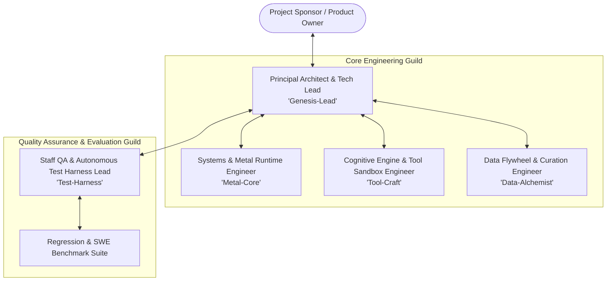
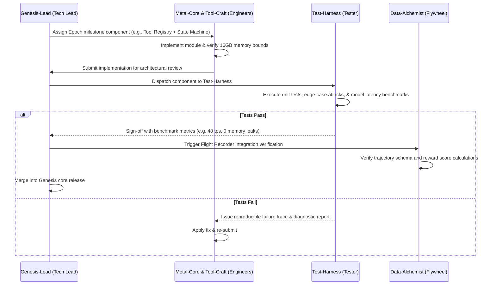

# Engineering Team Roster & Multi-Agent Organizational Structure ("Project Genesis")

> **Purpose**: Defines the specialized multi-agent engineering team assembled to implement, benchmark, test, and evolve the Project Genesis sovereign local AI assistant in accordance with [algo.md](file:///Users/sabyasachiroy/projects/Learning/Details/algo.md) and [implementation_plan.md](file:///Users/sabyasachiroy/projects/Learning/Details/implementation_plan.md).

---

## 1. Team Charter & Organizational Hierarchy

---

## 2. Specialized Agent Roles & Responsibilities

### 1. Principal Architect & Tech Lead (`Genesis-Lead`)
- **Job Title**: Principal Systems Architect & Technical Lead
- **Primary Domain**: Overall system orchestration, cognitive state machine implementation, system boundaries, and architectural reviews.
- **Core Responsibilities**:
  - Implements and maintains the Cognitive State Machine ($S \in \mathcal{S}$) defined in `algo.md`.
  - Enforces the 16 GB Unified Memory budget and zero-swap discipline across all components.
  - Reviews all code patches from team members before integration into the main codebase.
  - Arbitrates architectural tradeoffs (e.g., in-memory context size vs. KV cache memory consumption).

---

### 2. Staff QA & Autonomous Test Harness Lead (`Test-Harness`)
- **Job Title**: Principal QA Engineer & Model Evaluation Lead
- **Primary Domain**: Verification harnesses, test automation, model evaluation, and regression tracking.
- **Core Responsibilities**:
  - Implements the automated **Self-Verification Sub-Routine** ($\text{Verify}(\Delta)$).
  - Designs automated test suites for every tool (boundary testing, malicious path traversal inputs, syntax linting).
  - Evaluates local model outputs against standard coding benchmarks (e.g., Python AST linting, unit test generation accuracy, bug repair success rate).
  - Validates and verifies the ground-truth pass/fail signals that the Data Flywheel uses to tag SFT and DPO datasets.

---

### 3. Systems & Metal Runtime Engineer (`Metal-Core`)
- **Job Title**: Apple Silicon Systems & Runtime Engineer
- **Primary Domain**: Ollama daemon management, Metal MPS GPU offload, MLX integration, and memory profiling.
- **Core Responsibilities**:
  - Configures and verifies Metal GPU acceleration on the 8-core GPU.
  - Implements context window budgeting, token estimators, and sliding-window FIFO eviction to prevent memory spikes.
  - Manages Apple MLX runtime environments (`mlx-lm`) for local LoRA fine-tuning.
  - Monitors passive thermal performance and CPU/GPU throttling on the fanless MacBook Air.

---

### 4. Cognitive Engine & Tool Sandbox Engineer (`Tool-Craft`)
- **Job Title**: Tool Integration & Sandbox Security Engineer
- **Primary Domain**: Tool execution sandbox, file system safety gates, subprocess runner, and Tree-sitter AST parsing.
- **Core Responsibilities**:
  - Builds and hardens the tool registry (`read_file`, `write_file`, `replace_snippet`, `run_command`).
  - Implements the Pre-Execution Safety Gate (canonical path resolution, command blocklist).
  - Integrates Tree-sitter for semantic codebase indexing and symbol table extraction.
  - Generates unified git-style diffs with visual inspection previews before applying patches.

---

### 5. Data Flywheel & Curation Engineer (`Data-Alchemist`)
- **Job Title**: Data Flywheel & ML Fine-Tuning Engineer
- **Primary Domain**: Flight Recorder telemetry, trajectory evaluation, dataset curation, and LoRA training pipelines.
- **Core Responsibilities**:
  - Implements the Day-1 **Flight Recorder** to log all agent transitions without impacting inference latency.
  - Implements the multi-objective trajectory reward scoring function $R(\tau)$ from `algo.md`.
  - Builds the `curator.py` automated pipeline to format raw traces into clean SFT and DPO training sets.
  - Orchestrates the **Autonomous Sleep Daemon** (`genesis-sleep-daemon.py`) for idle-time Apple MLX LoRA training and manages the modular adapter registry (`adapter.npz`).

---

## 3. Collaborative Workflow & Evolutionary Testing Loop

The team operates through an iterative, feedback-driven development lifecycle:

---

## 4. Milestone Execution Plan for the Team

| Phase | Lead Engineer | Primary Deliverable | QA / Testing Gate |
| :--- | :--- | :--- | :--- |
| **Stage 1: Core Foundation** | `Metal-Core` + `Tool-Craft` | Ollama Metal setup, 16k context Modelfile, hardened tool registry | `Test-Harness`: Path traversal fuzzing, memory leak checks |
| **Stage 2: Cognitive State Machine** | `Genesis-Lead` | ReAct controller, state transitions, sliding-window FIFO eviction | `Test-Harness`: Multi-turn circular loop prevention ($K_{max}=3$) |
| **Stage 3: Verification & Mentorship Ingestion**| `Data-Alchemist` + `Tool-Craft`| Subprocess test runner, trajectory logger, verbal mentorship parser (`memory.db`) | `Test-Harness`: Verify trajectory JSON schema and rule retrieval accuracy ($\theta \ge 0.78$) |
| **Stage 4: Evaluation & Model Benchmarks**| `Test-Harness` | Coding benchmark harness (HumanEval subset, local git repo fixes) | Benchmark baseline generation speed ($\ge 40\text{ tps}$) and pass rate |
| **Stage 5: Sleep Daemon & MLX LoRA** | `Data-Alchemist` | Autonomous `genesis-sleep-daemon`, Apple MLX LoRA fine-tuner, dynamic adapter router | `Test-Harness`: Pre- vs. Post-adaptation regression evaluation |

---

## 5. Runtime Multi-Agent Swarm Worker Personas

When Genesis executes an autonomous goal via `genesis swarm "<goal>"` or `!SWARM <goal>`, the Genesis team instantiates the following dynamic worker personas coordinated via `SwarmCoordinator` (`genesis/core/swarm.py`):

1. **`Researcher` (Scout)**:
   - System Prompt: Codebase explorer, architectural investigator, dependency auditor.
   - Authorized Tools: `list_files`, `read_file`, `search_code`.
2. **`Implementer` (Architect / Builder)**:
   - System Prompt: Precision software developer, bug fixer, patch generator.
   - Authorized Tools: `read_file`, `write_file`, `replace_snippet`.
3. **`Tester` (Quality Assurance)**:
   - System Prompt: Test engineer, verification executor, reproduction author.
   - Authorized Tools: `run_command`, `read_file`, `write_file`.
4. **`Judge` (Arbiter / Lead Evaluator)**:
   - System Prompt: Objective gatekeeper verifying evidence, unit test outcomes, and code correctness.
   - Output: `GOAL_ACHIEVED: YES` or `GOAL_ACHIEVED: NO` with exact action points for the next iteration.

